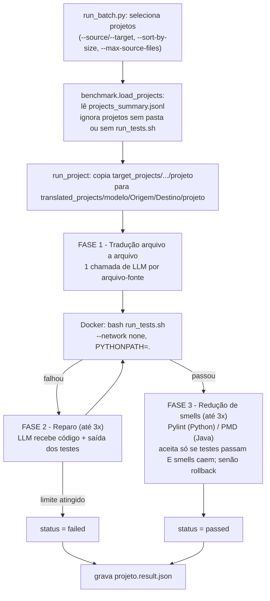

# Como Funciona o Fluxo de Tradução de Repositórios (`repo_translation`) e Comparação com o Pipeline Original do Artigo

Este documento descreve o que o código **realmente faz** (lido diretamente de `repo_translation/*.py`) e o compara com o pipeline original do artigo (`main.py`, `run_translation.py`, `test_suit.py`, `run_test_in_docker.py`, `run_code_smell_detection.py`).

---

## 1. Visão Geral em um Diagrama



---

## 2. Passo a Passo da Implementação

### 2.1 Carregamento do benchmark (`benchmark.py`)
- Lê `target_projects/projects_summary.jsonl`. Para cada linha monta um `Project` com:
  - `source_dir = source_projects/<Origem>/<projeto>` (código original);
  - `target_dir = target_projects/<Origem>/<Destino>/<projeto>` (**esqueleto do alvo**).
- Projetos listados no índice mas ausentes em disco, ou sem `run_tests.sh`, são **ignorados** (36 entradas do índice estavam nessa situação).
- O **esqueleto do alvo já contém os testes** (`tests/original/`, `public_tests/` ou `src/test/java/...`), `run_tests.sh` e `project_structure.txt`. A tarefa do LLM é produzir o código de produção que faça esses testes passarem.

### 2.2 Orquestração em lote (`run_batch.py`)
- Filtra por par de linguagens, ordena (opcionalmente por nº de arquivos-fonte), descarta projetos com 0 arquivos-fonte e aplica `--max-per-pair`.
- Verifica se a imagem Docker existe e instancia o cliente LLM (`build_client(provider, model=, base_url=)`).
- Grava em `translated_projects/<provider>[__<modelo>]/<Origem>/<Destino>/<projeto>/` e salva `<projeto>.result.json`.
- Pula projetos cujo resultado anterior é `passed` ou `failed`; reexecuta os que terminaram em `error` (ou todos com `--force`).

### 2.3 Fase 1 — Tradução inicial arquivo a arquivo (`run_project`)
1. Copia o esqueleto do alvo para o diretório de trabalho.
2. Lista os arquivos-fonte (`code_files(..., exclude_tests=True)`: ignora `tests/`, `public_tests/`, `build/`, `node_modules/` etc.).
3. Para **cada arquivo-fonte**, faz **uma chamada ao LLM** com um prompt composto por:
   - lista de arquivos do esqueleto (`scaffold`, até 8.000 caracteres);
   - `project_structure.txt` do alvo (até 4.000 caracteres), que descreve onde cada módulo deve ficar;
   - arquivos de build já existentes (`pom.xml`, `requirements.txt`...; `_config_context`);
   - arquivos já traduzidos (até 10.000 caracteres);
   - inventário dos arquivos-fonte e o conteúdo do arquivo atual;
   - lista dos caminhos gerados nos passos anteriores (últimos 6.000 caracteres).
4. O system prompt exige resposta **JSON** `{"files":[{"path":..., "content":...}]}` (JSON Mode nativo quando o provedor suporta, com 1 retentativa se o JSON vier inválido) e, para Java, informa as dependências Maven pré-cacheadas no container.
5. As edições passam por **guardas de segurança** (`_safe_path`):
   - rejeita caminhos absolutos, `..` e saída do diretório do projeto;
   - **bloqueia qualquer escrita em `tests/`, `public_tests/`, `original_tests/`, `test_*.py` e `*_test.*`**;
   - só aceita extensão da linguagem-alvo ou arquivos de build conhecidos; se o modelo devolve a extensão da linguagem de origem (ex.: `.java` num alvo Python), ela é trocada pela do alvo;
   - arquivos inválidos são descartados individualmente, em vez de abortar a resposta inteira.

### 2.4 Oráculo de testes (`evaluation.run_benchmark_tests`)
- Executa `docker run --rm --network none -e PYTHONPATH=. --mount <dataset>:/workspace --workdir <projeto> <imagem> bash run_tests.sh` (timeout de 600 s).
- Resultado funcional = **código de saída do script** (0 = aprovado), com duas proteções adicionadas por nós:
  - `exit 0` com **0 testes executados** (`Tests run: 0`, `collected 0 items`, `no tests ran`) é tratado como falha;
  - `Tests are skipped.` / `Not compiling test sources` (ex.: `maven.test.skip=true` inserido pelo modelo) também é tratado como falha.

### 2.5 Fase 2 — Reparo funcional (até `--max-corrections`, padrão 3)
- Enquanto os testes falham, envia ao LLM: `project_structure.txt`, arquivos-fonte (10.000 caracteres), arquivos traduzidos atuais (30.000), configs de build e **os últimos 8.000 caracteres da saída de `run_tests.sh`** (erros do `javac`/`pytest`).
- O modelo devolve apenas os arquivos a alterar; as edições são aplicadas e os testes reexecutados.
- **Não há rollback nesta fase** (uma correção pode piorar o resultado). Se a resposta vier vazia ou inválida, o loop é encerrado preservando o estado atual.

### 2.6 Fase 3 — Redução de code smells (até `--max-smell-iterations`, padrão 3)
- Só roda se os testes **passaram** e há smells (> 0).
- Python: `pylint --output-format=json` sobre todos os arquivos traduzidos; Java: PMD 7.1.0 (se não instalado no host, retorna `null` e a fase é omitida — foi o caso em todos os experimentos Python → Java).
- O LLM recebe o relatório do linter e devolve arquivos alterados. A edição só é **aceita se os testes continuam passando E a contagem de smells cai estritamente**; caso contrário, `_restore` devolve o conteúdo anterior.

### 2.7 Registro do resultado
`RepositoryRecord` grava: status (`passed`/`failed`/`error`), código de saída, nº de iterações de correção e de smells, smells após cada fase e os últimos 4.000 caracteres da saída dos testes.

---

## 3. Comparação com o Pipeline Original do Artigo

### 3.1 O que o pipeline original faz (`main.py`)
1. `prepare_dataset.load_to_cache` carrega programas isolados (CodeNet, Avatar, EvalPlus, EvoEval), cada um com casos de teste de entrada/saída.
2. `run_translation.run_translations`: **uma chamada de LLM por programa** (e por amostra, `number_of_translations_per_task`), com prompt escolhido por `prompt_selection_assignment.json` (8 prompts candidatos, `p1..p8`, atribuídos por modelo/dataset/par de linguagens). Modelos locais rodam via vLLM/HuggingFace (`temperature=1`, `top_p=0.92`, `top_k=50`, `max_tokens=6144`); GPT usa a API da OpenAI com truncamento do código a ~10.900 tokens.
3. `test_suit.run_tests` + `run_test_in_docker.py`: dentro do container `testing:t6` (limite de 500 MB), **compila** o código quando necessário e executa **cada caso de teste via stdin/stdout**, com timeout de 20 s por caso, classificando cada um como passou/falhou/exceção/timeout/estouro de memória/erro de compilação. Os resultados vão para CSVs (`tcos/...`).
4. `run_code_smell_detection`: Pylint (Python) e PMD (Java) sobre cada tradução, gravando os resultados em CSV.
5. `prompt_crafting_pipeline` (reparo iterativo): a cada iteração reenvia ao LLM o código fonte, a tradução anterior e **uma única mensagem de erro** escolhida por `get_error_message` na ordem: erro de compilação → exceção (stacktrace) → caso de teste que falhou/estourou tempo/memória (mostrando **entrada e saída esperada**) → **code smells** (somente quando nenhum teste falha). Cada iteração regrava a tradução inteira, sem verificar se piorou.

### 3.2 Tabela comparativa

| Aspecto | Pipeline original (artigo) | `repo_translation` (nossa implementação) |
| --- | --- | --- |
| **Unidade de tradução** | 1 programa/arquivo isolado | Repositório inteiro, multi-arquivo, **1 chamada por arquivo-fonte** |
| **Saída do LLM** | Código puro (remove cercas ```` ``` ````) | JSON `{"files":[{path, content}]}` com múltiplos arquivos e arquivos de build |
| **Contexto do prompt** | Só o código-fonte do programa | Esqueleto do alvo, `project_structure.txt`, configs, arquivos já traduzidos, inventário do repositório |
| **Seleção de prompt** | 8 prompts candidatos escolhidos estatisticamente por modelo/dataset/par | **Um prompt fixo** de sistema; sem seleção |
| **Modelos / execução** | vLLM/HuggingFace local + OpenAI (`temperature=1`, amostragem) | APIs compatíveis com OpenAI (Gemini, OpenAI, Groq, Nexforce), `temperature=0`, **1 amostra** por projeto (sem pass@k com k>1) |
| **Oráculo de teste** | Casos de entrada/saída executados pelo próprio harness (`run_test_in_docker.py`), granularidade por caso | `bash run_tests.sh` do benchmark dentro do container; **resultado = código de saída** (binário por repositório) |
| **Isolamento** | Container `testing:t6`, 500 MB | Container `repotransbench-pyjava:latest`, `--network none`, dataset montado em `/workspace` |
| **Compilação** | Etapa explícita em `compile_code` (Java/Rust/Scala) | Embutida no `run_tests.sh` (`mvn clean test` compila main + test) |
| **Code smells** | Pylint/PMD sobre cada tradução, medido ao fim | Mesmos analisadores (Pylint/PMD), mas usados também como **feedback** na Fase 3 |
| **Reparo iterativo** | **Loop único e misto**: falha de teste → corrige; senão smells; sem checar regressão; reescreve o código inteiro | **Duas fases separadas**: reparo funcional (até 3x) e depois smells com **gate de teste + rollback** |
| **Feedback de erro** | **1** erro aleatório por vez (compilação, exceção ou caso de teste com entrada/saída esperada) | **Últimos 8.000 caracteres** da saída completa do `run_tests.sh` (todos os erros de compilação/asserções) |
| **Proteção contra trapaça** | Desnecessária (harness externo e imutável) | Necessária: bloqueio de edição de testes, detecção de `0 testes` e `tests skipped` |
| **Backtranslation (RQ3)** | Implementado (`run_backtranslation`) | **Não implementado** |
| **Persistência** | CSVs (`tco_*.csv`, `llm_code_smell_results.csv`) | Um `*.result.json` por projeto |

### 3.3 O que é equivalente e o que é novo
- **Conceitos reaproveitados do artigo:** execução isolada em Docker, os mesmos analisadores de smells (Pylint e PMD 7.1.0), a ideia de reparo iterativo guiado por feedback de execução, e a separação entre corretude funcional e qualidade.
- **Inovações da nossa implementação:** granularidade de repositório, protocolo de edição por JSON com validação de caminhos, oráculo `run_tests.sh`, reparo e smells em fases separadas com rollback, e proteções contra reward hacking e falsos-positivos.
- **Não reaproveitado (ficou fora do escopo):** seleção de prompts, backtranslation, amostragem múltipla (`k>1`), modelos locais via vLLM e os CSVs de resultados por caso de teste.
- **Contraparte funcional do artigo que executamos:** o pipeline original foi reproduzido em escala no dataset EvalPlus (492 traduções via Gemini; 136.589 resultados de casos de teste em `tcos/llm/tco_25408.csv`, resumidos em `results/evalplus_translations_summary.csv`), servindo de referência direta para a comparação de granularidade (função vs. classe vs. repositório).

---

## 4. Limitações e Cuidados de Interpretação

1. **Os testes não são totalmente ocultos ao modelo.** O conteúdo dos testes nunca entra no prompt de tradução (`code_files(..., exclude_tests=True)` e `_config_context` ignoram esses diretórios), mas os **nomes/caminhos** dos arquivos de teste aparecem no `scaffold`, e o `project_structure.txt` descreve o papel de cada arquivo de teste. Já na Fase 2 o modelo vê as **mensagens de erro** dos testes (que revelam assinaturas esperadas). Isso é relevante para Python → Java, onde o gargalo é justamente descobrir tipos/assinaturas exigidos por `testCompile`.
2. **O contexto "de assinaturas" é, na prática, uma lista de caminhos.** A variável `signatures` acumula apenas os nomes dos arquivos gerados, não as assinaturas públicas reais. A consistência entre arquivos depende do trecho de "arquivos já traduzidos" (limitado a 10.000 caracteres) — projetos grandes podem perder coerência entre módulos.
3. **A Fase 2 não tem rollback.** Uma correção pode regredir o estado anterior; só a Fase 3 é protegida por gate de teste.
4. **Resultado binário por repositório.** `passed` exige 100% dos testes; por isso é útil reportar também a proporção de testes individuais aprovados (extraída da saída do `pytest`/Maven).
5. **Uma única amostra determinística (`temperature=0`).** Diferente do artigo (amostragem com `pass@k`), não há medida de variabilidade entre execuções; as comparações entre modelos usam n = 10 por par de linguagens e devem ser lidas como indicativas.
6. **Smells em Java não medidos.** Sem o PMD instalado no host, `smells_*` é `null` para todos os alvos Java.
7. **Ruído do benchmark.** Parte dos projetos é inviável (testes que dependem de binário externo, bug no próprio teste, repositório sem código traduzível), o que reduz o teto de aprovação independentemente do modelo.
